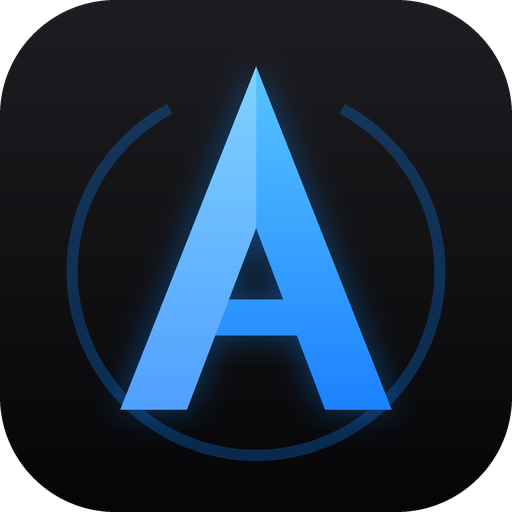

<p align="center"></p>

# AresPilot

**AresPilot** is a Clash of Clans autopilot by **AresEmu**, built for the **new Clash of
Clans UI (October 2026)**.

It is **based on [BasePilot](https://github.com/efebolukbasi/BasePilot) by Efe Bolukbasi**
(MIT license). The original project was written for the previous UI; most of its screen
detection, the builder menu and the wall upgrade flow stopped working after the update.
AresPilot rewrites those parts, adds a new interface and new features on top (Builder Base
Trophy mode, Baby Dragon edge deploy, ...).

Credit for the original design and code goes to the BasePilot author. AresPilot is not an
official BasePilot release and is not supported by them.

> ⚠️ **Read the [Disclaimer](#disclaimer) before using it.** Automating Clash of Clans
> violates Supercell's Terms of Service. This project exists for **educational purposes
> only** and you use it **entirely at your own risk**.

Windows desktop app for **Clash of Clans on Google Play Games (PC)**. It plays the game
the way a person does: screen capture, computer vision and clicks. No memory reading, no
packet manipulation, no modified client.

---

## Feature status

| Status | Meaning |
|---|---|
| ✅ Working | Implemented and tested in real runs on the new UI |
| 🧪 Not fully tested | Implemented, but only briefly or not yet tested live |
| 🚧 Work in progress | Being rewritten for the new UI, not usable yet |
| 📋 Planned | Not started yet, to be released |

### ✅ Working (new UI, 16:9)

- **New UI support (16:9 profile).** All Home Village templates re-cropped at 2560×1440
  for the October 2026 UI.
- **New interface.** Black, Apple-style desktop app: sidebar with icons, Start / Stop in
  the page header, iOS-style switches, centred number fields.
- **Builder Base on the new UI.** Village detection, boat, Find Now, attack, battle end,
  Return Home and the Star Bonus popup use templates re-cropped for the
  new UI. Baby Dragon army with the Battle Machine / Flying Machine.
- **Builder Base wall upgrades.** Same flow as the Home Village (Build panel + Upgrade
  More), with its own threshold in millions (one decimal, e.g. 1.3M).
- **Builder Base loot modes.** *Gold* (end the battle at 2 stars), *Both* (at 1 star),
  *Elixir* (surrender right after deploying).
- **Auto upgrade via the new Build panel ("Buildings & Heroes").** Opens the panel with
  the Build button, scans the whole list, reads names and costs, and confirms upgrades.
  Modes: **Maxer**, **Rusher**, **Dry run** (logs only, clicks nothing).
- **Wall upgrades via the Build panel.** Triggered by the full-storage icon. Finds the
  Wall row, picks the cheapest payable wall level, uses **Upgrade More** to batch walls
  in the multi-select bar, pays with gold or elixir and confirms the "Upgrade Walls"
  popup. Up to two rounds per check; the second round only runs if a wall level is still
  payable after re-reading the HUD. Wall prices are re-read every time (never cached to
  disk). The number of walls recorded is taken from the actual HUD drop (cost ÷ price per
  wall), so the summary stays correct even if the batch counter is off.
- **New price and HUD reader.** Prices and gold/elixir/dark elixir amounts are read with a
  dedicated digit-glyph matcher instead of Tesseract, with thousands-grouping checks and
  red-text detection (unaffordable prices).
- **Both confirm dialog layouts.** Works with and without the Gold Pass (discounted price
  layout vs yellow banner layout).
- **Safe popup handling.** Gem-spend dialogs, panels and unknown popups are closed via their
  X / Cancel buttons — never a blind Okay/Confirm.
- **End-of-run summary.** When a run ends, a summary window and log entry show run time,
  number of attacks, farmed gold/elixir/dark elixir, and walls upgraded grouped by level
  with their cost.
- **Robust loot tracker.** HUD amounts are only accepted when two frames agree. A sudden
  "collapse" (e.g. 9,000,000 read as 6) triggers a re-read, and if it persists the previous
  value is held for one cycle instead of counting a fake loss or a fake gain. Real spends
  (walls, upgrades) are not counted as farmed loot.
- **More human-like attacks.** Heroes are dropped at random points of the perimeter and
  hero abilities fire 0–10 s after each hero is deployed. Troop placement
  (Valkyrie, Super Minion, Sneaky Goblin) was reworked:
  - troops follow random waypoints inside a **3.5-tile band** along each side, joined by a
    half-smoothed curve (a gentle, irregular wave rather than a perfect spline);
  - drops land **between tiles** too, not only on tile centres (irregular spacing of
    0.2–0.45 tiles);
  - drag speed changes **±30% per hop**, and each side takes ±10% of its share of time;
  - **corners are crossed faster** (≈1.4× with its own ±30% variation each time) to avoid
    big troop clumps where two sides meet;
  - **Valkyrie** deploy lasts **7 s**; **Super Minion** deploy lasts a new random
    **2.8–4.2 s** every attack.
- **Full zoom-out before attacking**, so the first attack after the menus is not zoomed in.
- **Faster template matching.** Coarse-to-fine matching with a template cache
  (~4× faster per call).
- **Reliable list scrolling.** The Build panel list is checked to have actually moved and
  stopped before it is read.
- **Settings auto-save** on every change; Duration field fixed.
- **AresPilot data folder.** Settings, logs and debug frames live in
  `%LOCALAPPDATA%\AresPilot`; on the first start, settings from an older `BasePilot`
  install are copied over automatically (the old folder is left untouched).
- **Separate test logs.** Unit tests write to `%LOCALAPPDATA%\AresPilot\test_logs`
  (see `ARESPILOT_LOG_DIR`) so they never pollute the real run log.

### 🧪 Implemented but not fully tested

- **Builder Base Trophy mode.** Never ends the battle early: plays the first village to
  100%, then attacks the second village with the surviving dragons and the fresh cards,
  and waits for the battle to finish before Return Home.
- **Baby Dragon edge deploy (Builder Base, both stages).** Full zoom-out, then the bot reads
  the red "no deploy" border around the village and drops one dragon per zone in six zones
  around it, a random **2–8 tiles** outside the border, all within ~3 s. Zones never land
  off the playable floor, on the HUD, on the troop bar or on the buttons: a blocked zone
  comes closer to the border or slides along it. The machine is dropped with one of the
  dragons; all abilities fire together after a random 10–25 s. In the second village the
  bot first taps a building with a dragon selected to make the game show the border.
- **Missed-drop retries.** Dragons the game did not take (their card still shows the troop
  switch button) are dropped again closer to the border, up to 5 rounds.
- **Last run remembered.** Village, army, Builder Base mode, duration and all switches of
  the Run page come back as they were at the last Start.
- **Rusher mode** on the new Build panel.
- **Timed event "Pick a Reward!" overlay** (33/66/100% damage): the bot now clicks the
  right-hand card (gold or grey, whatever it contains) instead of waiting ~12 s for the
  countdown. When the event is over and the overlay never shows up, attacks run as before.
  See [docs/event-rewards.md](docs/event-rewards.md).
- **Sneaky Goblin** with the new troop placement (shares the Valkyrie/Super Minion code,
  not run live yet).
- **Earthquake "Random Placement"** after the fix.
- **Gem dialog recovery** in rare cases (seen once during a large elixir batch, cause not
  confirmed).
- **Run until maxed / idling** logic with the new panel (inherited from upstream, not
  re-verified over long sessions).

### 🚧 Work in progress

- **Faster wall rounds.** Remember where the Wall row is during a run (not on disk) and
  start the scan from there, cutting most of the list scrolling (~+10% attacks/h
  expected with walls on).
- **Faster Stop.** Pressing Stop can take 6–9 s to take effect mid-attack (spell and hero
  deploy, OCR passes are not interruptible yet). Goal: ~1–1.5 s.
- **Wall batch counter.** The fallback wall count is one short per batch (the first
  selected wall isn't counted). Harmless today because the HUD-drop count is used, but it
  will be corrected as a safety net.
- **Stuck-screen timeout loop.** A known case where the bot can keep retrying the same
  recovery step after a timeout.
- **Player list / multi-run.** The Players page shows "Work in progress" while the
  player list and multi-run are reworked.
- **Night Witches** (Builder Base): listed in the UI, not implemented yet.

### 📋 Planned / to be released

- **Laboratory chip on the new UI** (lab status in Live status, max 2 labs).
- **Multi-account** support.
- **Timer** function.
- **Skipping low-loot bases.**
- **16:10 profile** update for the new UI (only the 16:9 profile is updated for now).

Not automated (as upstream): starting laboratory research and Pet House upgrades.

## Measured performance

Numbers from real runs on the October 2026 UI (16:9, Google Play Games, October 2026).
They depend on your army, Town Hall level, league and PC, so treat them as a reference,
not a promise.

**Long run — Super Minion army, wall upgrades on (1 h 31 min):**

| Metric | Result |
|---|---|
| Attacks | 133 (**~88 per hour**, one every ~41 s including wall rounds) |
| Gold farmed | 80.9 M (**~53 M/h**) |
| Elixir farmed | 85.7 M (**~56 M/h**) |
| Walls upgraded | 82 (level 13 → 14, 164 M spent, **~54 walls/h**) |
| Wall rounds | 10 rounds, ~21% of the run time |
| Errors / loot-tracker anomalies | 0 / 0 |

**Builder Base — Baby Dragon army, wall upgrades on (1 h 05 min):** 91 attacks
(**~84 per hour**) and 59 walls upgraded.

**Attack rate by army:**

| Army | Walls off | Walls on |
|---|---|---|
| Super Minion | 101–107 attacks/h (~34–36 s per attack) | 85–88 attacks/h |
| Valkyrie | — | 66–67 attacks/h (~54 s per attack) |

**Timings:**

- Super Minion attack cycle (search → deploy → return home): ~27–38 s.
- Wall round (scan the Build panel list, batch, pay, confirm): ~1 min, most of it spent
  scrolling the list to find the Wall row.
- Template matching: ~4× faster per call than upstream thanks to coarse-to-fine matching
  and the template cache.

## Safety rails

Automation that spends resources has to be careful, so AresPilot:

- Never confirms a purchase whose price shows red (unaffordable → gem-spend risk).
- Checks that the confirm dialog matches the picked row (name, price and resource) before
  clicking Confirm.
- Verifies every upgrade actually started by checking the builder counter afterwards.
- Closes unknown dialogs via their close button or empty ground — never a blind "Okay".
- Keeps a gold buffer so matchmaking entry fees are never spent on walls.
- Saves screenshots of anything it couldn't verify to `%LOCALAPPDATA%\AresPilot\debug\`
  instead of retrying blindly.

## Download

Grab the latest **`AresPilot.exe`** from the
[Releases page](https://github.com/AresEmu/BasePilot-Ares/releases) — a single
file, no install needed (Tesseract is bundled). Windows SmartScreen may warn about an
unsigned exe: choose *More info → Run anyway*. Read the [Disclaimer](#disclaimer) first.
What changed in each version: [CHANGELOG](CHANGELOG.md).

## Requirements

- Windows 10/11
- Clash of Clans running in **Google Play Games on PC**, with the October 2026 UI
- The game rendering at **16:9** (the only profile updated for the new UI)

## Running from source

Python 3.11+ on Windows (tested with Python 3.13):

```
pip install -r requirements.txt
python main.py
```

Part of the OCR (building names, wall bar title) still uses Tesseract 5. For development,
AresPilot falls back to `C:\Program Files\Tesseract-OCR\tesseract.exe`, so a
[UB-Mannheim build](https://github.com/UB-Mannheim/tesseract/wiki) is enough, or point
`TESSERACT_CMD` at any `tesseract.exe` you prefer.

To build the one-file exe, copy that Tesseract install (`tesseract.exe`, its DLLs and
`tessdata/`) into `tesseract_bundle/` and run:

```
pip install pyinstaller
pyinstaller AresPilot.spec
```

Settings and logs live in `%LOCALAPPDATA%\AresPilot` (settings from an older `BasePilot`
folder are copied over on the first start).

### First run

1. Open the game, then press **Test** on the Settings page to confirm AresPilot can see
   it. Use **Auto-detect** or pick the window manually if needed.
2. On the Run page, choose your army, set **Auto upgrade → Dry run** for the first session
   and press **Start**. Watch the Logs page to see what it would do.
3. Happy with its choices? Switch to **Maxer** and enable **Upgrade walls** if you want.

### Army setup

**Home Village:** the same as upstream: be on the Home Village, use the default deploy
bar layout, and keep your army at the top of Saved Recipes.

**Builder Base:** Baby Dragons in every camp, plus the Battle Machine or the Flying
Machine. Pick *Builder Base* on the Run page, choose a *Prioritise* mode (the **?** button
explains each one) and press Start.

See [docs/armies.md](docs/armies.md) for deploy details.

## License

MIT — see [LICENSE](LICENSE).

- Original BasePilot: © 2026 Efe Bolukbasi.
- AresPilot (October 2026 UI update, new interface and all later changes): © 2026 AresEmu,
  released under the same MIT license.

If you reuse this code, keep both copyright notices, as the MIT license requires. Tesseract, bundled into the exe, ships
under the Apache 2.0 license.

## Disclaimer

Automating Clash of Clans **violates Supercell's Terms of Service and can get your
account banned.** AresPilot, like the original BasePilot, is published **for educational
purposes only**: it is an exercise in computer vision, OCR and UI automation against an
animated, adversarial target. Use it on an account you're willing to lose, or don't use
it at all. **No warranty; you use it at your own risk and accept all consequences.**

Not affiliated with, endorsed by, or associated with Supercell. Clash of Clans is a
trademark of Supercell Oy.
