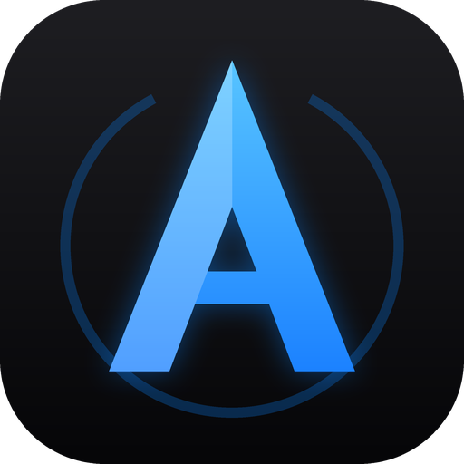

<div align="center">



# AresPilot

**A Clash of Clans autopilot for Windows, built for the new 2026 game UI.**

[](https://github.com/AresEmu/AresPilot/releases/latest)
[](LICENSE)
[](#requirements)

[**Download**](https://github.com/AresEmu/AresPilot/releases/latest) ·
[Quick start](#quick-start) ·
[Features](#features) ·
[Troubleshooting](#troubleshooting) ·
[Changelog](CHANGELOG.md)

</div>

> [!WARNING]
> **Personal educational project.** AresPilot is a study in computer vision, OCR and desktop
> automation. It is not affiliated with Supercell, and the author does not condone cheating:
> automating Clash of Clans breaks Supercell's Terms of Service and can get an account banned.
> Read the [Disclaimer](#disclaimer) before using it.

AresPilot runs Clash of Clans on **Google Play Games for PC** through screen capture, image
recognition and clicks only. No memory reading, no modified client, no network access of its own.
Everything it stores (settings, logs) stays on your PC.

It is based on [BasePilot](https://github.com/efebolukbasi/BasePilot) by Efe Bolukbasi (MIT),
which was written for the previous game UI. AresPilot rewrites the parts the update broke and
adds a new interface and new features.

## Features

- ⚔️ **Home Village farming**: Valkyries, Sneaky Goblins, Super Minions or Electro Dragons,
  with heroes, siege machine and Earthquakes.
- 🐉 **Builder Base farming**: Baby Dragons with the Battle Machine or Flying Machine, and four
  loot modes (Gold, Both, Elixir, Trophy).
- 🧱 **Wall upgrades** in both villages, in batches, as soon as your storages reach a threshold.
- 🏗️ **Auto upgrade** of buildings and heroes through the Build panel (Maxer, Rusher, Dry run).
- 🎁 **Rewards handled**: event reward cards, end-of-battle chests and Star Bonus chests.
- 🛡️ **Safe by design**: never confirms a red (unaffordable) price, checks every dialog before
  confirming, closes unknown popups instead of pressing Okay.
- 📊 **Run summary**: time, attacks, loot farmed and walls upgraded at the end of every run.

The full list, with what is tested and what is still in progress, is in
[docs/features.md](docs/features.md).

## Quick start

### 1. Download

Get **`AresPilot.exe`** from the [latest release](https://github.com/AresEmu/AresPilot/releases/latest).
It is a single file: nothing to install. Windows SmartScreen may warn because the exe is not
signed; choose *More info → Run anyway*.

### 2. Set up the game

- Play Clash of Clans in **[Google Play Games for PC](https://play.google.com/googleplaygames)**.
- Set the game language to **English** (*Settings → Language*). AresPilot reads English
  buttons and names.
- Use a **16:9** monitor (1920×1080, 2560×1440, ...). Ultrawide or 16:10 monitor? See
  [this fix](#ultrawide-or-1610-monitor).
- Don't minimise the game while the bot runs. Your mouse stays free: clicks go straight to
  the game window.

### 3. Prepare your army

| Run page choice | Army to bring |
|---|---|
| Home Village · **Valkyries** | Valkyries. Save the army as a recipe that starts with Valkyries, at the top of *Saved Recipes*. |
| Home Village · **Sneaky Goblins** | Sneaky Goblins |
| Home Village · **Super Minions** | Super Minions |
| Home Village · **Edrags** | 12 Electro Dragons |
| **Builder Base** | Baby Dragons in every camp + Battle Machine or Flying Machine |

In the Home Village the bot also uses heroes, a Log Launcher or Siege Barracks, a Super Dragon
and Earthquake spells when you bring them. Other troops and spells are not deployed.

### 4. Run

Open AresPilot, accept the disclaimer (first start only), then on the **Run** page:

1. pick the **village** and the **attack strategy** that match your army;
2. pick how long: a **duration**, **Run until maxed** (until you press Stop) or **Star Bonus**;
3. optionally turn on **Upgrade walls** or **Auto upgrade**;
4. press **Start**.

You can start from either village: the bot takes the boat if needed. The **Logs** page shows
what it is doing; **Stop** ends the run and shows a summary.

<details>
<summary><b>What do the Run page options do?</b></summary>

- **Auto upgrade**: *Maxer* starts the cheapest affordable upgrade (never the Town Hall),
  *Rusher* upgrades the Town Hall first, *Dry run* only writes in the log what it would do.
- **Upgrade walls**: spends gold and elixir on walls. The trigger threshold and the builders
  kept free are in *Settings*.
- **Ranked attack fill**: uses your **ranked** attacks. Leave it off unless you want that.
- **Builder Base · Prioritise**: *Gold* ends the battle at 2 stars, *Both* at 1 star, *Elixir*
  surrenders right after deploying, *Trophy* plays both villages to the end.
- **Star Bonus**: stops once the daily Star Bonus is claimed (at most 15 minutes).

</details>

## Requirements

- Windows 10 or 11
- Clash of Clans on Google Play Games for PC, with the October 2026 UI, in English
- A 16:9 game picture (tested at 2560×1440; other 16:9 sizes are scaled)

## Troubleshooting

<details>
<summary><b>"Clash of Clans window not found"</b></summary>

Open the game first. If it is open, go to **Settings**, select the Clash of Clans window in the
list, press **Test**, then **Use this window**.

</details>

<details>
<summary><b>The log is full of <code>... .png not found</code></b></summary>

The game is not in English, not 16:9, or not on the new UI. Check [step 2](#2-set-up-the-game).

</details>

<details>
<summary><b>"Troops not found 4 times in a row — stopping"</b></summary>

The army in the game does not match the strategy chosen on the Run page. Check
[step 3](#3-prepare-your-army).

</details>

<details>
<summary><b>"Could not read the window size"</b></summary>

The game window is minimised. Restore it.

</details>

<a name="ultrawide-or-1610-monitor"></a>
<details>
<summary><b>Ultrawide or 16:10 monitor</b></summary>

Google Play Games gives the game the shape of your monitor when the game starts. To get a
16:9 game on another monitor:

1. In AresPilot open **Settings** and click **Switch display to 16:9**.
2. Fully close Clash of Clans, then open it again.
3. Click **Restore my display**. The game stays 16:9.
4. Select the game window in Settings and press **Test**: it must show `(16:9)` and
   `Surface OK to use.`

Repeat this every time you restart the game.

</details>

<details>
<summary><b>Where are the logs and settings?</b></summary>

In `%LOCALAPPDATA%\AresPilot`. The log is `arespilot.log`; the **Open in Explorer** button on
the Logs page opens its folder.

</details>

## Run from source

<details>
<summary><b>Run with Python, or build the exe yourself</b></summary>

You need **Python 3.11+** (tick *Add python.exe to PATH* in the installer) and
**Tesseract OCR 5** in its default folder, `C:\Program Files\Tesseract-OCR`:

```
winget install UB-Mannheim.TesseractOCR
```

Then:

```
git clone https://github.com/AresEmu/AresPilot.git
cd AresPilot
pip install -r requirements.txt
python main.py
```

If Tesseract is somewhere else, set `TESSERACT_CMD` to the full path of `tesseract.exe`.

**Build the exe:** copy all the contents of `C:\Program Files\Tesseract-OCR` into a
`tesseract_bundle` folder (so that `tesseract_bundle\tesseract.exe` exists), then:

```
pip install pyinstaller
python -m PyInstaller --noconfirm AresPilot.spec
```

The exe is `dist\AresPilot.exe`. Deploy details for each army are in
[docs/armies.md](docs/armies.md).

</details>

## License

MIT, see [LICENSE](LICENSE).

- Original BasePilot: © 2026 Efe Bolukbasi.
- AresPilot (October 2026 UI update, new interface and all later changes): © 2026 AresEmu,
  released under the same MIT license.

If you reuse this code, keep both copyright notices, as the MIT license requires. Tesseract,
bundled into the exe, ships under the Apache 2.0 license.

## Disclaimer

**Educational purpose only.** AresPilot is a personal project, made to learn and
experiment with computer vision, OCR and desktop UI automation on an animated, complex
target. It is shared as source code for that purpose only.

**The author does not condone cheating.** Automating Clash of Clans violates Supercell's
Terms of Service and can get an account permanently banned. The author does not approve
of, encourage or support using AresPilot — or any other bot — to play the game, gain an
advantage over other players, or break the Terms of Service, for any reason. If you choose
to run it anyway, you do so on your own initiative, at your own risk, and you alone are
responsible for the consequences. **No warranty of any kind** (see [LICENSE](LICENSE)).

**No affiliation with Supercell.** AresPilot is not affiliated with, endorsed, sponsored or
approved by, or in any way connected to Supercell Oy. Clash of Clans, its name, logos,
characters and in-game graphics are trademarks and copyrighted material of Supercell Oy.
The small image crops in `templates/` are screenshots of the game's interface, used only
so the software can recognise what is on screen; all rights to them remain with Supercell.

**No support for gameplay use.** The author does not provide help for using AresPilot on
an account, and issues or requests about evading detection, bans or anti-cheat systems
will not be answered or accepted.

**Removal on request.** If Supercell or any rights holder has a concern about this
repository, please open an issue or contact the author through GitHub and the content will
be reviewed and removed where appropriate.
